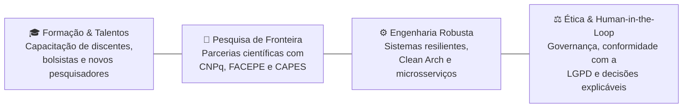

# Centro de Inteligência Artificial — UNICAP
### Universidade Católica de Pernambuco

**Inovação Tecnológica, Pesquisa Aplicada e Inteligência Artificial com Propósito Acadêmico e Social**

  
  
  
  

---

## 🌐 Sobre o Centro de Inteligência Artificial (CIA)

O **Centro de Inteligência Artificial (CIA)** da **Universidade Católica de Pernambuco (UNICAP)** é um ecossistema pioneiro dedicado à pesquisa científica, desenvolvimento de software avançado e inovação tecnológica.

Nossa missão é conectar a fronteira da pesquisa em inteligência artificial com desafios reais do ensino superior, da gestão acadêmica e da comunidade, desenvolvendo soluções cognitivas de alto impacto prático, sustentável e ético.

---

## 🏛️ Nossos Pilares Fundamentais

1. **Pesquisa & Inovação Aplicada:** Concepção e entrega de pipelines cognitivos que modernizam a experiência educacional e otimizam processos institucionais complexos.
2. **Formação de Novos Talentos:** Integração de estudantes de graduação e pós-graduação em projetos reais de engenharia de software e IA (PIBIC, PIBITI e estágios formativos), preparando líderes para o mercado e a academia.
3. **Engenharia de Software de Alto Nível:** Prática rigorosa de padrões de arquitetura limpa, tipagem estática, testes automatizados e observabilidade completa.
4. **Governança, Ética e Privacidade:** Rigorosa conformidade com a LGPD, soberania de dados com inferência cognitiva *on-premise* e o compromisso inegociável do ser humano sempre no centro da decisão (*Human-in-the-Loop*).

---

## 🔬 Linhas de Pesquisa e Áreas de Atuação

- **Visão Computacional & Digitalização:** Segmentação inteligente de documentos, restauração de acervos históricos, leitura óptica de caracteres (OCR) de alta precisão e validação biométrica/documental.
- **Processamento de Linguagem Natural & Agentes Cognitivos:** Grafos de orquestração de estados, Retrieval-Augmented Generation (RAG) especializado e assistentes conversacionais multimodais com suporte a voz em tempo real.
- **Sistemas de Informação & Apoio à Decisão:** Indexação vetorial para busca semântica em acervos científicos, cruzamento automatizado de requisitos regulatórios e esteiras de triagem preditiva.
- **Ecossistema de Microsserviços Distribuídos:** Serviços cognitivos conteinerizados de alta vazão, mensageria orientada a eventos e telemetria distribuída.

---

## 💻 Tecnologias que Fazem Parte do Nosso Dia a Dia

| Domínio | Tecnologias Principais |
| :--- | :--- |
| **Linguagens & Runtimes** | Python 3.11+, TypeScript, SQL |
| **Backend & APIs** | FastAPI, Pydantic v2, SQLAlchemy, Celery, RabbitMQ |
| **Frontend & Interfaces** | Angular (Standalone Components & Signals), Tailwind CSS |
| **IA & Computação Cognitiva** | LangGraph, LangChain, PyTorch, Qdrant Vector DB, PaddleOCR |
| **DevOps & Observabilidade** | Docker, Docker Compose, PostgreSQL 16, OpenTelemetry |

---

## 🤝 Parcerias e Conexões Institucionais

As iniciativas desenvolvidas pelo CIA atendem a diversos setores da **UNICAP** e colaboram ativamente com o ecossistema de ciência e tecnologia de Pernambuco e do Brasil:
- **Pró-Reitoria de Pesquisa e Pós-Graduação (PROPESP)**
- **Diretoria de Gestão e Relacionamento (DGR)**
- **Diretoria de Ação Social (DAS)**
- **Agências de Fomento:** CNPq, FACEPE e CAPES

---

📍 **Universidade Católica de Pernambuco (UNICAP)**  
Rua do Príncipe, 526 — Boa Vista, Recife - PE, Brasil  
[Portal Oficial da UNICAP](https://portal.unicap.br)

